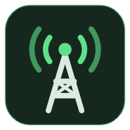
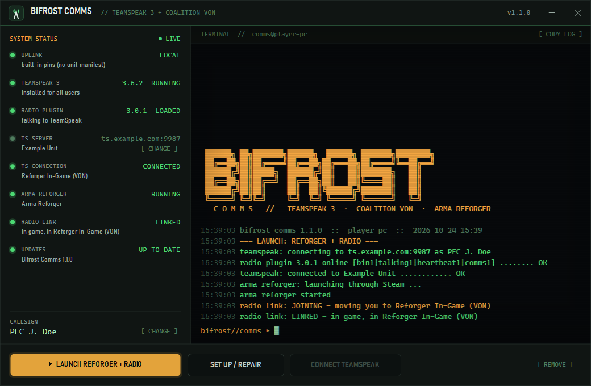
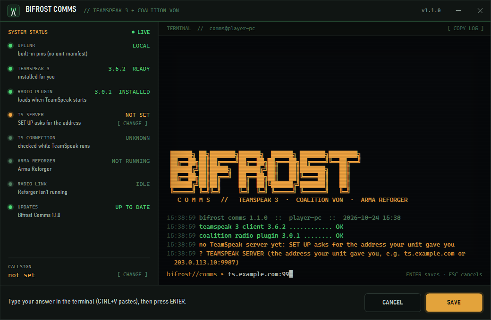

<p align="center"></p>

<h1 align="center">Bifrost Comms</h1>

<p align="center"><b>Get your Arma Reforger players on Coalition VON with one download.</b><br>
TeamSpeak 3, the Coalition plugin, your server and the game, set up and launched from one small Windows program.</p>

<p align="center"><a href="https://github.com/25thplaymaking/bifrost-comms/releases/latest"><b>Download the latest release</b></a></p>

---

[Coalition VON](https://github.com/CoalitionArma/Coalition-VON) gives Arma Reforger real radio and proximity voice
through TeamSpeak 3. It's great once it works. Getting a new player there is the hard part: the *right* TeamSpeak (3,
not 5 or 6), the plugin in the right folder, the right server, the plugin actually loaded, and the game started after
all of that. Every unit ends up writing the same guide and answering the same questions in Discord.

Bifrost Comms does all of it for them. You hand your players one zip. They double-click, type a callsign, and press
**LAUNCH**.



## What your players get

- **TeamSpeak 3 installed** if it's missing: the official installer, checked against a pinned SHA-256, installed for
  their Windows user only (no admin prompt for TeamSpeak), with TeamSpeak's bundled **Overwolf offer blocked**.
- **The Coalition TeamSpeak plugin installed** into TeamSpeak's plugins folder, checked the same way, and updated when
  you move to a new release.
- **TeamSpeak connected to your server** with their callsign as nickname and a bookmark added.
- **A "Reforger + Radio" desktop shortcut**: TeamSpeak on your server, the plugin checked, then Arma Reforger through Steam.
- **A live status board** for every link in the chain: TeamSpeak, plugin, your server, the TeamSpeak connection, the
  game, and the radio link itself (standby, joining the VON channel, linked, game frozen). When something is wrong,
  it says what and what to do.
- **RADIO CHECK, one button for "my radio won't link".** It looks at everything between the game and TeamSpeak on the
  player's PC, says in plain words what is wrong, and fixes what it can with one click (see [RADIO CHECK](#radio-check)).
  It also runs by itself when the link stays stuck.
- **No runtime to install.** It's a ~140 KB program on the .NET Framework every Windows 10 and 11 PC already has.

## Set it up for your unit (about two minutes)

1. Download **`BifrostComms.exe`** and **`comms.json`** from the [latest release](https://github.com/25thplaymaking/bifrost-comms/releases/latest).
2. Open `comms.json` in Notepad and fill in your TeamSpeak server:

   ```json
   {
     "name": "Example Unit",
     "host": "ts.example.com",
     "port": 9987,
     "password": "",
     "bookmark": "Example Unit",
     "manifest": ""
   }
   ```

3. Put the two files in one zip and share it however you onboard people: Discord, your website, your welcome post.
   Players unzip and run `BifrostComms.exe`.

That's it. On first run it installs itself to `%LOCALAPPDATA%\Bifrost Comms` (with your `comms.json`), makes the
shortcuts, and walks the player through SET UP.

**No comms.json?** It still works: SET UP asks the player for your server address, and they can paste it (an address,
`address:port`, or a `ts3server://` link). Players can change it later with **CHANGE** next to TS SERVER.

### comms.json

| Field | What it is |
| --- | --- |
| `name` | Your unit's name, shown to players ("Connect TeamSpeak to *name* now?"). Defaults to the address. |
| `host` | Your TeamSpeak 3 server's address: a name (`ts.example.com`) or an IPv4 address. |
| `port` | Its voice port. Default `9987`. |
| `password` | The server password, if it has one. Leave it empty and TeamSpeak asks the player instead. |
| `bookmark` | The name of the bookmark added in TeamSpeak. Defaults to `name`. |
| `manifest` | Optional. An `https://` address of your own manifest (below). Leave it empty to use the pins built into the release. |

> **Tip:** use the same address your players would type into TeamSpeak's Connect box. If your address relies on a DNS
> SRV record (no port, and the name itself doesn't point at the server), put the server's direct `host:port` here, or the
> status board can't tell that TeamSpeak is on your server.

## For players

1. Unzip and run `BifrostComms.exe`. Windows may say *"Windows protected your PC"* because the program isn't
   code-signed: click **More info**, then **Run anyway**.
2. Press **SET UP**. It installs whatever is missing and asks for your callsign (your TeamSpeak name).
3. From then on, use the **Reforger + Radio** shortcut on your desktop. Keep the window open to watch the radio link.

To uninstall, press **REMOVE**. TeamSpeak and the plugin stay (they belong to TeamSpeak).



## RADIO CHECK

Coalition VON needs several things on a player's PC to line up, and when one doesn't, the symptom is always the same:
the radio never links. **RADIO CHECK** (the button beside CONNECT TEAMSPEAK) looks at all of them, says in plain words
what is wrong, and puts a button beside each problem it can fix itself. Every fix asks first; **NOT NOW** leaves things
as they are. Pressing the button also prints everything it looked at, so **COPY LOG** gives your admins the whole picture.

It runs by itself, once each time, when the radio link stays stuck: the plugin not loaded for 45 seconds, TeamSpeak not
linking the radio for 30 seconds, no signal from the game for 3 minutes, on a radio server but not spawned for 2.5
minutes, or at once when the game keeps its radio files in another folder (that can't fix itself).

| It finds | It does |
| --- | --- |
| **Reforger keeps its radio files in another folder.** Steam's launch option `-profile` moves them, as does a Documents folder that lives in OneDrive. The plugin only reads `Documents\My Games\ArmaReforger\profile`, so it never sees the game. | **LINK THE FOLDERS**: the plugin's folder becomes a link (a directory junction, no admin rights) to the game's real profile folder. What was there moves aside to `profile.bifrost-old` and is kept, never deleted. The player's profile, settings and mods stay where they are. TeamSpeak restarts if it was open. LAUNCH offers the same link before it starts anything, so no restart is needed. |
| A different TeamSpeak 3 is running than the one SET UP put the plugin in (a portable copy, an old install). | **INSTALL IT THERE**, then restarts TeamSpeak. |
| TeamSpeak older than 3.6 (the plugin needs TeamSpeak's plugin API 26). | **UPDATE TEAMSPEAK** installs the pinned version. Bookmarks and settings stay. |
| The plugin is installed but TeamSpeak hasn't loaded it. | If Microsoft's Visual C++ runtime is missing, **GET THE RUNTIME** opens Microsoft's download. Otherwise **RESTART TEAMSPEAK**. |
| In game, but TeamSpeak isn't on your server. | **CONNECT TEAMSPEAK**. |
| In game, but your server isn't TeamSpeak's selected tab (the plugin only serves the selected tab), or the plugin can't see the connection, or TeamSpeak hasn't moved the player into the radio channel. | Says which tab to click, or to tell your admins that the channel or its password may have changed. |
| No signal from the game, and Windows' Controlled folder access is on. | **OPEN WINDOWS SECURITY** at the page where `ArmaReforgerSteam.exe` and `ts3client_win64.exe` can be allowed. |
| No signal from the game and nothing wrong on the PC. | Says to join a radio server and spawn in. |

How it knows where the game keeps its files: the running game's own command line when Windows shows it, otherwise
Steam's launch options for Reforger (the signed-in account's, or the `-profile` every account on the PC agrees on).
`-profile <name>` means `Documents\My Games\<name>\profile`, a full path gets `\profile` added, and a relative path
starts from the game's folder. It also looks for a fresh game heartbeat in any other `My Games\...\profile` folder
(OneDrive's Documents, say), and asks the local TeamSpeak (ClientQuery) which tab is selected.

## Safety and privacy

- **Every download is pinned.** TeamSpeak 3.6.2 comes from teamspeak.com and the Coalition plugin 3.0.1 from
  Coalition's GitHub releases, each checked against a SHA-256 built into the program (the plugin's DLL too). A file that
  doesn't match is deleted, never run.
- **Per user, no admin.** Everything goes in the player's own profile. Only the Microsoft Visual C++ runtime that
  TeamSpeak needs may ask Windows for permission, and only if it's missing.
- **Overwolf stays off.** TeamSpeak 3.6.2's silent installer launches an Overwolf downloader. Bifrost Comms blocks the
  offer and stops any Overwolf installer that starts during the install.
- **No telemetry.** It talks to teamspeak.com and GitHub for the pinned downloads, to your manifest if you set one, and
  to DNS to look up your server (and opens Microsoft's download page only if the player presses GET THE RUNTIME).
  Nothing about the player is sent anywhere.
- **Read-only on the game side, unless the player presses a fix.** It reads the files Coalition's mod and plugin
  exchange in `Documents\My Games\ArmaReforger\profile`, asks the local TeamSpeak (ClientQuery on 127.0.0.1) which
  server, channel and tab it's on, and, for RADIO CHECK, reads the game's command line and Steam's launch options for
  Reforger on that PC. It writes to none of them. The one exception is the **LINK THE FOLDERS** button (and LAUNCH's
  offer of the same), which replaces the plugin's profile folder with a link to the game's; the old folder is kept beside
  it. RADIO CHECK sends nothing about the player anywhere.
- **Open source.** Everything is in this repository, and it builds with one command on any Windows PC.

## Optional: a unit manifest

Want to move all your players to a new Coalition plugin, a new Bifrost Comms build, or a new server without sending a new
zip? Host a JSON file (GitHub Pages, your website, a raw file in a repo) and put its `https://` address in `manifest`.
Every player's copy reads it on start. Any section you leave out, or any field that's wrong, keeps the built-in value.

```json
{
  "plugin": {
    "name": "Coalition TeamSpeak Plugin",
    "version": "3.0.1",
    "url": "https://github.com/CoalitionArma/Coalition-VON/releases/download/3.0.1/Coalition_TeamSpeak_Plugin_3.0.1.ts3_plugin",
    "sha256": "911175464ec47ceae176961d01fa7f4a7b948843dfefae1244f6c81812227adf",
    "size": 53109,
    "dll": "CRF_Teamspeak_Plugin_Main.dll",
    "dll_sha256": "e0ea673bbbc99c45122e2423f0d7d0bc98757d3e06535305e91048a1fb901cbe"
  },
  "launcher": {
    "version": "1.2.0",
    "url": "https://github.com/<you>/<repo>/releases/download/v1.2.0/BifrostComms.exe",
    "sha256": "<sha256 of that exe>",
    "size": 115712,
    "notes": "what changed"
  },
  "server": { "name": "Example Unit", "host": "ts.example.com", "port": 9987 }
}
```

- `plugin`: the release to install. Without `dll_sha256` only the package is hash-checked (handy if you follow
  Coalition's releases as they come out).
- `launcher`: a newer Bifrost Comms. Players update on their next start. The exe's file version must equal `version`,
  or the update is refused. `url` may be relative to the manifest.
- `server`: overrides `comms.json`'s server for everyone (players can't change it then). Also takes `bookmark` and
  `password`.
- `teamspeak` (`version`, `url`, `sha256`, `size`) pins a different TeamSpeak 3 installer.
- The manifest must be served over https and isn't fetched through redirects, so use its final address.

## Build from source

Windows, nothing to install (it uses the C# compiler that ships with Windows):

```powershell
.\build.ps1 -Version 1.2.0     # build\BifrostComms.exe, build\CommsTests.exe, build\icons\
.\build\CommsTests.exe         # 260+ checks; pictures of the window in build\renders\
```

Linux, with Mono (for development; release builds come from Windows):

```bash
VERSION=1.2.0 ./build.sh
xvfb-run -a mono build/CommsTests.exe
```

The checks cover `comms.json` and address parsing, the manifest (and a damaged one), downloads (hash, size, redirects,
cancel), the plugin package (path traversal, pinned DLL hash, all-or-nothing swap), finding TeamSpeak through the
registry, ClientQuery against a fake client, the game's bridge files and every radio-link state, settings, the Overwolf
guard and the update version guard, and RADIO CHECK: `-profile` (names, full, relative and network paths) and Steam's
launch options (signed-in account, accounts that disagree), every diagnosis, RADIO CHECK start to finish with a window
that declines every offer, the "stuck for long enough" timing of the automatic run, the heartbeat and runtime searches,
the running TeamSpeak's install, the folder link (a real junction in a temp folder, Windows only) and LAUNCH's link before
it starts anything. The checks never accept an offer that would run an installer or close TeamSpeak.

Command line: `--launch` (what the shortcut runs), `--setup` (run SET UP at once), `--no-game` (never start Steam).

## How it works

| Link | How |
| --- | --- |
| Program -> your server | `comms.json` (copied next to the installed program), or what the player typed. An optional manifest can override it. |
| Program -> TeamSpeak | A `ts3server://` link (connect, nickname, password, bookmark), and TeamSpeak's ClientQuery (`127.0.0.1:25639`, API key from the client's own `clientquery.ini`) to see which server, channel and tab it's on. |
| Game <-> plugin | Coalition's files in `Documents\My Games\ArmaReforger\profile`: `VONPluginInfo.json` (plugin alive), `VONServerData.json` (in game, VON channel), `VONHeartbeat.json` (game alive, every second while it's on a radio server). Bifrost Comms only reads them; RADIO CHECK can link this folder to the game's when the game keeps its files elsewhere. |

| File | What |
| --- | --- |
| `src/Program.cs` | Start, command line |
| `src/TerminalForm.cs` | The window (all painted, so the tests can draw any state) |
| `src/Comms.cs` | Setup, launch, watching (and when to run RADIO CHECK by itself), installing and updating itself, shortcuts, removal |
| `src/Unit.cs` | `comms.json` and server addresses |
| `src/TeamSpeak.cs` | Finding and installing TeamSpeak, the plugin package, ClientQuery, the Overwolf guard |
| `src/Bridge.cs` | The game <-> plugin files and the radio-link state |
| `src/Doctor.cs` | RADIO CHECK: what the PC shows, the diagnosis, the folder link, Steam's launch options |
| `src/Manifest.cs` | The built-in pins and the optional manifest |
| `src/Net.cs` | Downloads with SHA-256 checks |
| `src/Instance.cs` | One copy at a time; a second start hands its request over |
| `src/Look.cs` | Colours, fonts, the icon, JSON |
| `tests/CommsTests.cs` | The checks |
| `tools/IconMaker.cs` | Draws `comms.ico` at build time |

## Credits

Coalition VON (the Reforger mod and the TeamSpeak plugin) is made by [COALITION](https://github.com/CoalitionArma).
Bifrost Comms only downloads their published releases; all credit for the radio goes to them. TeamSpeak is a trademark
of TeamSpeak Systems GmbH. This project isn't affiliated with COALITION, TeamSpeak Systems or Bohemia Interactive.

## License

[MIT](LICENSE)
